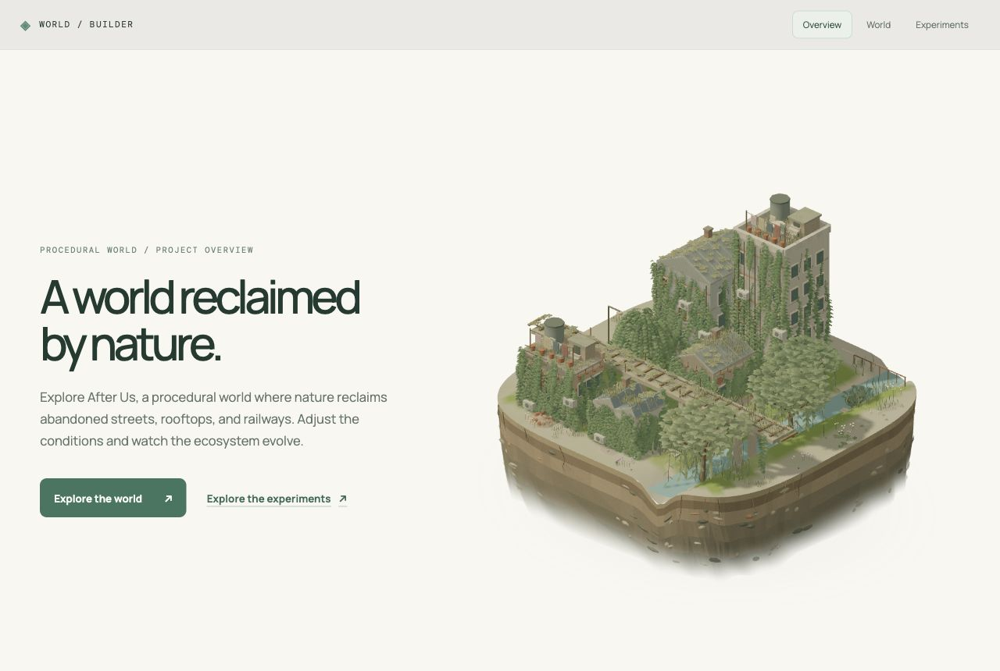

# Procedural World Building — After Us

**Nature reclaims the world.**

*A world shaped by what we leave behind.*

After Us is an interactive procedural world where vegetation gradually reclaims abandoned streets, rooftops, railways, and waterways. The user acts as an ecological caretaker: adjust environmental conditions, explore connected districts, and observe how plant growth and structural weathering change the landscape over time.

After Us explores generative world design through seeded randomness, coherent noise, spatial constraints, shape grammars, local growth rules, and real-time rendering. These systems work together to create an explorable, evolving environment. Nine standalone experiments examine individual techniques and related systems.



## Contents

- [Run locally](#run-locally)
- [Explore the application](#explore-the-application)
- [After Us world](#after-us-world)
- [Overview cutout](#overview-cutout)
- [Procedural systems](#procedural-systems)
- [Experiments](#experiments)
- [Architecture and performance](#architecture-and-performance)
- [Verification](#verification)
- [Optional cloud saves](#optional-cloud-saves)
- [Current scope](#current-scope)
- [Project notebook](#project-notebook)

## Run locally

Use **Node.js 22.12 or newer**, npm, and a browser with WebGL support. The application uses React 19, Three.js, React Three Fiber, Drei, and Vite 8. Firebase is optional.

```bash
npm install
npm run dev
```

Open the local URL printed by Vite. To use the development address used in the project previews:

```bash
npm run dev -- --host 127.0.0.1 --port 5178 --strictPort
```

Then open `http://127.0.0.1:5178/#overview`.

For a production build and local production preview:

```bash
npm run build
npm run preview
```

The build output is written to `dist/`.

## Explore the application

Routes are URL fragments appended to the running application's address.

| Area | Route | Experience |
| --- | --- | --- |
| Overview | `#overview` | An automatically evolving miniature neighborhood and entry points to the world and experiments |
| World | `#world` | The interactive After Us environment, district navigation, ecological controls, and building decay |
| Experiments | `#experiments` | Nine independent studies with their own controls and visualizations |

## After Us world

### Explore connected districts

The world extends through procedurally generated districts containing housing, courtyards, glassworks, railway infrastructure, and ruins. Terrain and infrastructure use shared world coordinates so neighboring areas meet consistently.

- **Drag** to pan into adjacent districts.
- **Right-drag** to orbit; **scroll** to zoom.
- Use the **district arrows** to move between neighboring areas.
- Use **↺ View** to reset the camera or **Return to the Old Exchange** to return to the starting district.

### Controls

| Section | Controls and effects |
| --- | --- |
| **Time & Evolution** | Scrub **Elapsed Years** from 0–80, play/pause, advance five years, choose simulation speed, or return to Year 0. Years drive ecological succession and structural weathering together. |
| **Day & Night Cycle**, within Time & Evolution | Scrub **Time of Day** continuously from 00:00–24:00. Sun/moon direction, intensity, sky, ambient color, water color, and shadows transition through dawn, daylight, golden hour, dusk, and night. **Auto Cycle** completes a day in three minutes. |
| **Environmental Conditions** | Adjust long-term sunlight, humidity, soil health, and water level. These affect habitat suitability, growth, and exposure. |
| **Buildings & Decay** | Control density, courtyard/street/cluster layouts, height, material, and weathering rate. Inspect aging checkpoints at Years 0, 20, 40, 60, and 80. |
| **Vegetation & Growth** | Select mixed succession, climbers, meadow plants, or woodland; adjust seed availability, growth rate, and dispersal. |
| **Explore the Ecosystem** | Switch between Natural, Light, Moisture, Soil, and Ecological Impact views to inspect conditions and infrastructure effects. |
| **World Generation** | Reproduce a world from a seed or generate a new seed. |

**Time of Day and Elapsed Years are independent.** The daily cycle changes the scene's lighting; it does not advance years or simulate daily photosynthesis. The environmental Sunlight control and Light overlay describe long-term exposure.

Changing a condition recomputes the simulated state at the selected year, including while playback is paused. Ground cover, facade growth, connected habitats, moisture, and building condition describe the **current district at that simulated year**. They are model outputs, not measured environmental data or validated forecasts.

### Vegetation and structural change

Ten botanical forms include clover, ferns, grasses, reeds, shrubs, cascading ivy, sedum, broadleaf trees, birches, and willows. Curved leaves, layered canopies, and muted flowers give the vegetation a softer miniature appearance. Species form patches according to moisture, shade, and proximity to water; roofs, walls, and open ground provide different habitats.

Buildings use modular facades, windows, rooftop details, and varied roof forms: pitched cottages and townhouses, sawtooth workshops, arched entrances, domed conservatories, barrel glasshouses, and open trusses. Placement reserves space for streets, neighboring foundations, railways, and canals.

Weathering accumulates with elapsed years, dampness, exposure, and root pressure, with different resistance by material. Surfaces develop cracks and plaster loss; walls break along uneven profiles, slabs retain supported sections, and masonry collects in rubble piles below. Openings change local light, soil, and growth barriers. Plants stay attached to the visible supporting walls, roofs, and frames.

## Overview cutout

The landing page presents a draggable, rotatable diorama using the same architecture and botanical generators as the main world, with its own showcase configuration.

- **Interactive viewing:** drag with a mouse or one finger to rotate; use arrow keys when the canvas is focused. Double-click or press Home to restore the opening view. The growth loop continues while rotating.
- **Six varied buildings:** a broader five-storey block, three-storey residence, two-storey arcade, low cottage, workshop, and domed conservatory. Staggered footprints leave alleys and open space around the railway and canal.
- **An excavated land section:** a curved outline, deep layered soil, embedded stones and brick fragments, exposed roots, and a softly fading underside. A transparent canvas blends the model into the page background.
- **A 32-second growth loop:** bare ruins transition to mature vegetation, hold for eight seconds, and fade before restarting. Five cached ecological states cover Years 0–80; the architecture stays at its prepared Year 32 condition throughout this presentation loop.
- **Reduced activity when appropriate:** rendering pauses offscreen and in hidden tabs. Reduced-motion preferences display a still Year 60 scene.

The [visual system and streaming notes](docs/planning/after-us-visual-system.md) document the shared terrain, architecture, vegetation, palette, and lighting direction.

## Procedural systems

| Concept | Application in After Us |
| --- | --- |
| Seeded randomness | Reproducible district layouts, building details, plant candidates, and weathering variation |
| Coherent spatial fields | Continuous terrain and habitat patches that organize vegetation by local conditions |
| Constraint-based placement | Building clearance around infrastructure and neighboring footprints; plant spacing and rooting restrictions |
| Shape grammars | Building footprints expand into floors, facade bays, roof structures, and architectural details |
| Local neighborhood rules | Ground cover evolves through growth, carrying capacity, and nearby seed dispersal; roads and sealed surfaces limit spread |
| Coupled systems | Building shade affects plants; weathering creates openings; exposed surfaces and structural support affect growth |
| Instancing and levels of detail | Shared plant and architectural geometry render many repeated elements with less work |

The experiments below investigate these ideas individually and explore additional techniques such as voxel modeling and branching histories.

## Experiments

| Study | What it demonstrates | Notes |
| --- | --- | --- |
| Noise Lab · `#experiments/noise` | Seeded signal sources, shaping, a 2D grayscale map, and a linked 3D grid | [Noise Lab study](docs/studies/noise-lab.md) |
| Terrain Field · `#experiments/terrain` | Seeded height fields, thermal erosion, a 2D survey, analytical surface views, and tiled exploration | [Terrain Field study](docs/studies/terrain-field.md) |
| Scattering Studio · `#experiments/scatter` | Terrain-aware asset populations with independent layers and seeded clusters | [Scattering Studio study](docs/studies/scattering-studio.md) |
| Pathways · `#experiments/paths` | Editable splines projected onto terrain as roads or rivers | [Pathways study](docs/studies/pathways.md) |
| Flow Field · `#experiments/flow` | Particle trails and vector arrows for river currents or atmospheric motion | [Flow Field study](docs/studies/flow-field.md) |
| Voxel World · `#experiments/voxel` | Three-dimensional density fields, ordered shape operations, a live cross-section, and four meshed chunks | [Voxel World study](docs/studies/voxel-world.md) |
| Shader Lab · `#experiments/shaders` | Six terrain treatments and a separate vertex-ripple view, including camera-responsive color and shoreline contact | [Shader Lab study](docs/studies/shader-lab.md) |
| Branching Forms · `#experiments/branching` | Seeded tree and ivy grammars with an inspectable skeleton and distance-based detail | [Branching Forms study](docs/studies/branching-forms.md) |
| Worldlines · `#experiments/worldlines` | A rule-driven branching history with 32 reproducible possible end states | [Worldlines study](docs/studies/worldlines.md) |

## Architecture and performance

React manages navigation and controls; React Three Fiber and Three.js render the scenes. Procedural generation and simulation are separated from rendering so deterministic rules can be verified directly in Node.js.

- A **module worker** prepares the active district first, then nearby districts within a two-district radius. New requests supersede obsolete queued work.
- **Bounded caches** retain generated district models and selected-year snapshots. Nearby districts use detailed architecture and foliage; distant districts use simpler geometry.
- **Shared meshes and instancing** reuse botanical forms and repeated structural parts. Visible foliage instances are packed into reusable buffers.
- The **overview** prepares geometry and ecological snapshots once, then interpolates growth and updates instance transforms and ground colors at up to 30 frames per second.

| Source | Responsibility |
| --- | --- |
| [src/App.jsx](src/App.jsx), [src/PortfolioPages.jsx](src/PortfolioPages.jsx) | Navigation, overview, and experiment entry points |
| [src/features/after-us/](src/features/after-us/) | District generation, ecology, architecture, decay, lighting, streaming, and world controls |
| [previewModel.js](src/features/after-us/previewModel.js), [WorldCutout.jsx](src/features/after-us/WorldCutout.jsx), [cutoutGeology.js](src/features/after-us/cutoutGeology.js) | Landing-page neighborhood composition, growth loop, rendering, and exposed soil section |
| [src/features/](src/features/) | Individual experiment implementations and optional preset library |
| [scripts/](scripts/) | Deterministic verification scripts |
| [docs/](docs/) | Study notes, tutorials, design decisions, and screenshots |

## Verification

Run `npm run build` to check the production bundle. The available deterministic checks are:

```bash
npm run verify:noise
npm run verify:environment
npm run verify:terrain
npm run verify:voxel
npm run verify:presets
npm run verify:branching
npm run verify:after-us
```

The After Us check covers district continuity, ecological responses, building placement and aging, structural support, botanical geometry, the continuous day/night cycle, streaming/cache behavior, and the overview's neighborhood proportions and growth loop. Visual review in the browser complements these checks for composition, animation, lighting, and responsive layout.

## Optional cloud saves

Terrain Field and Voxel World include a Firebase-ready personal save/load library. They store compact generator configurations and view settings; loading regenerates geometry from those inputs.

The application works without Firebase. To enable cloud saves, copy `.env.example` to `.env.local`, supply the Firebase Web app configuration, enable Google Authentication and Firestore, and deploy the repository's rules and indexes. See the [configuration guide and verification status](docs/planning/firebase-save-load.md) for the complete workflow.

## Current scope

- After Us is a deterministic visual simulation prototype. Ecological succession and structural damage use simplified rules; debris motion is a visual approximation.
- Growth is computed on each district's local grid. Terrain and infrastructure connect across districts; ecology does not run as one global population simulation.
- World controls and simulation state are session-only. After Us cloud persistence and natural-language controls are future work.
- The overview uses a curated showcase configuration. The nine experiments remain standalone studies; Branching Forms and Worldlines are also session-only.

## Project notebook

Start at the [documentation index](docs/README.md) for study notes, implementation decisions, screenshots, and verification references. The [tutorial path](docs/tutorial/README.md) explains the web, React, Three.js, procedural-generation, UI, and persistence concepts. For the current world's visual direction and behavior, see the [After Us design notes](docs/planning/after-us-visual-system.md).
