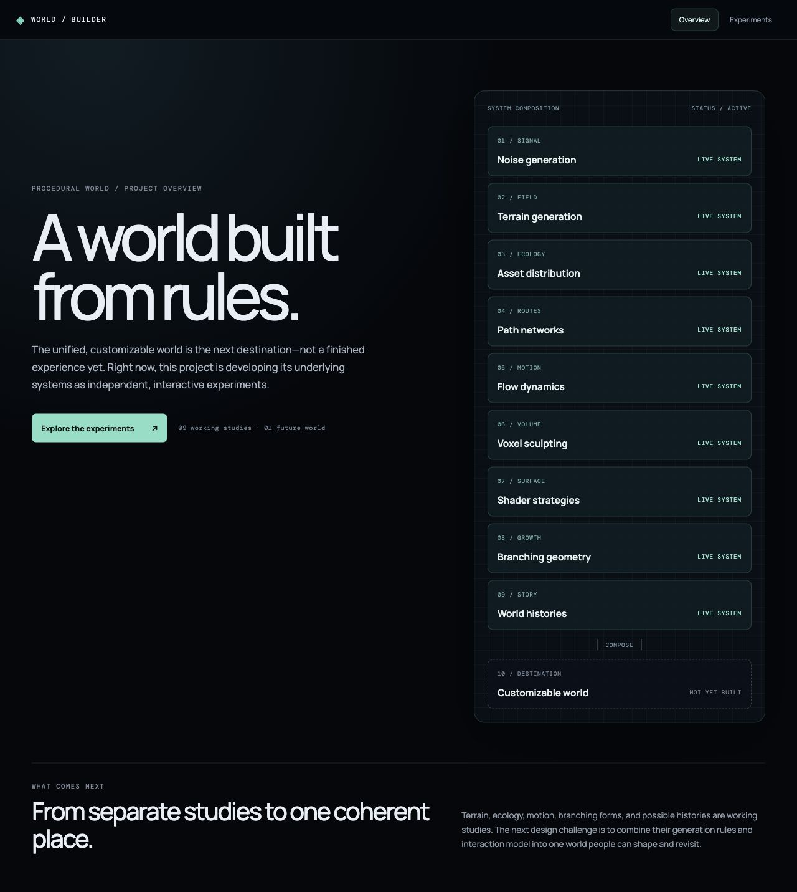

# Procedural World Building

An evolving procedural-world portfolio. Nine interactive studies explore noise, terrain, asset distribution, paths, flow, volume sculpting, surface treatments, branching geometry, and possible histories. The unified customizable world is the next destination, not a finished feature.



## Contents

- [Explore the studies](#explore-the-studies)
- [Project notebook](#project-notebook)
- [Run and verify](#run-and-verify)
- [Cloud configuration library](#cloud-configuration-library)
- [Current boundary](#current-boundary)

## Explore the studies

| Study | What it demonstrates | Notes |
| --- | --- | --- |
| Noise Lab · `#experiments/noise` | Seeded signal sources, shaping, a 2D grayscale map, and a linked 3D grid | [Noise Lab study](docs/studies/noise-lab.md) |
| Terrain Field · `#experiments/terrain` | Seeded height fields, thermal erosion, a 2D survey, analytical surface views, and tiled exploration | [Terrain Field study](docs/studies/terrain-field.md) |
| Scattering Studio · `#experiments/scatter` | Terrain-aware asset populations with independent layers and seeded clusters | [Scattering Studio study](docs/studies/scattering-studio.md) |
| Pathways · `#experiments/paths` | Editable splines projected onto terrain as roads or rivers | [Pathways study](docs/studies/pathways.md) |
| Flow Field · `#experiments/flow` | Particle trails and vector arrows for river currents or atmospheric motion | [Flow Field study](docs/studies/flow-field.md) |
| Voxel World · `#experiments/voxel` | Three-dimensional density fields, ordered shape operations, a live cross-section, and four meshed chunks | [Voxel World study](docs/studies/voxel-world.md) |
| Shader Lab · `#experiments/shaders` | Six terrain treatments and a separate vertex-ripple view, including camera-responsive color and shoreline contact | [Shader Lab study](docs/studies/shader-lab.md) |
| Branching Forms · `#experiments/branching` | Seeded tree and ivy grammars with an inspectable skeleton and distance-based detail | [Branching Forms study](docs/studies/branching-forms.md) |
| Worldlines · `#experiments/worldlines` | A rule-driven branching history with 32 reproducible possible end states | [Worldlines study](docs/studies/worldlines.md) |

The main site overview remains about the future world. The studies live in the secondary **Experiments** area.

## Project notebook

Start at the [documentation index](docs/README.md) for the study notes, technical tutorials, implementation decisions, screenshots, and verification references. The [tutorial path](docs/tutorial/README.md) explains the underlying web, Three.js, procedural-generation, UI, and persistence concepts.

## Run and verify

```bash
npm install
npm run dev
```

Open the local URL printed by Vite. For a production build and deterministic checks:

```bash
npm run build
npm run verify:noise
npm run verify:environment
npm run verify:terrain
npm run verify:voxel
npm run verify:presets
npm run verify:branching
```

## Cloud configuration library

Terrain Field and Voxel World include a Firebase-ready personal save/load workflow. They save compact generator configurations, not geometry. The studies remain usable without a Firebase project; live cloud saves require a Web app configuration, Authentication, Firestore, and deployed rules. See [configuration and verification status](docs/planning/firebase-save-load.md).

## Current boundary

These systems are not yet composed into a single world. Branching Forms and Worldlines are standalone, session-only studies; their settings are not in the Firebase configuration library. The repository documents implemented behavior separately from future integration ideas.
