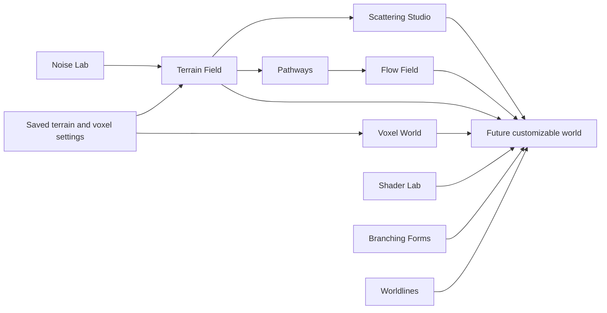

# Project notebook

This notebook records the working systems behind Procedural World Building. Read the [portfolio overview](../README.md) first if you want the short project story; use this index to move between visible studies, implementation decisions, and technical walkthroughs.

## Interactive studies

| Study | Visual record | Technical notes |
| --- | --- | --- |
| Noise Lab | [Screenshot](assets/screenshots/noise-lab.jpg) | [Signal study](studies/noise-lab.md) |
| Terrain Field | [Screenshot](assets/screenshots/terrain-field.jpg) | [Height-field study](studies/terrain-field.md) |
| Scattering Studio | [Screenshot](assets/screenshots/scattering-studio.png) | [Population study](studies/scattering-studio.md) |
| Pathways | [Screenshot](assets/screenshots/pathways.png) | [Spline study](studies/pathways.md) |
| Flow Field | [Screenshot](assets/screenshots/flow-field.png) | [Motion study](studies/flow-field.md) |
| Voxel World | [Screenshot](assets/screenshots/voxel-world.jpg) | [Volume-field study](studies/voxel-world.md) |
| Shader Lab | [Surface screenshot](assets/screenshots/shader-lab.jpg) · [Ripple screenshot](assets/screenshots/shader-ripple.jpg) | [Visual-system study](studies/shader-lab.md) |
| Branching Forms | [Screenshot](assets/screenshots/branching-forms.png) | [Growth study](studies/branching-forms.md) |
| Worldlines | [Screenshot](assets/screenshots/worldlines.png) | [Possible-histories study](studies/worldlines.md) |

## Technical path

The [tutorial index](tutorial/README.md) starts with the browser and scene stack, then moves through materials, generation, controls, and persistence. These are learning references; paths in standalone examples are illustrative unless a page explicitly points to the current implementation.

## Implementation decisions

- [Terrain generation and shaping](planning/procedural-terrain-milestone-1.md)
- [Study sequence and coverage audit](planning/study-sequence-audit.md)
- [Environment systems and boundaries](planning/environment-systems.md)
- [Branching geometry and possible histories](planning/branching-systems.md)
- [Erosion, shader views, and streaming](planning/procedural-terrain-milestone-2.md)
- [Voxel volume and meshing](planning/voxel-world-study.md)
- [Firebase-ready configuration saves](planning/firebase-save-load.md)

## System map

The arrows into the world describe the intended composition, not functionality already shipped. Screenshots in this notebook were captured from the local application; they are not third-party concept art.
