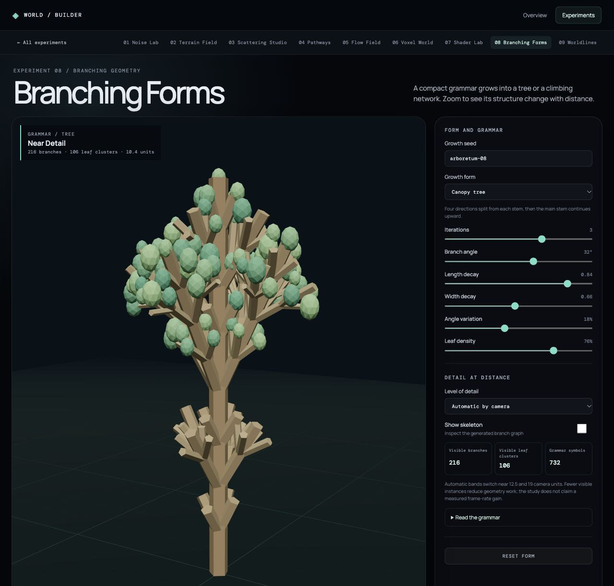

# Branching Forms

Branching Forms turns a short symbol grammar into visible growth. The same turtle interpreter renders two forms: a three-dimensional canopy tree and planar ivy growing against a wall. Seeded variation changes segment angles and lengths without breaking reproducibility.

The controls expose iteration count, branch angle, length and width decay, angle variation, leaf density, and a skeleton view. Brackets save and restore turtle state; turn symbols change its heading. Geometry is bounded to four interactive iterations and a symbol budget, so an aggressive grammar cannot grow without limit.

The detail selector compares near, middle, and far representations. Automatic mode changes the visible branch and leaf instances at camera-distance thresholds. The readout reports visible geometry counts rather than claiming a measured frame-rate improvement. Both branch cylinders and leaf clusters render as instanced meshes.

Grammar expansion and model generation live in [`createBranching.js`](../../src/features/branching/createBranching.js); the interactive renderer is [`BranchingForms.jsx`](../../src/features/branching/BranchingForms.jsx). Run `npm run verify:branching` for reproducibility, bounds, and detail-reduction checks. The generated tree is a standalone form study; Scattering Studio still uses its simpler asset geometry.
