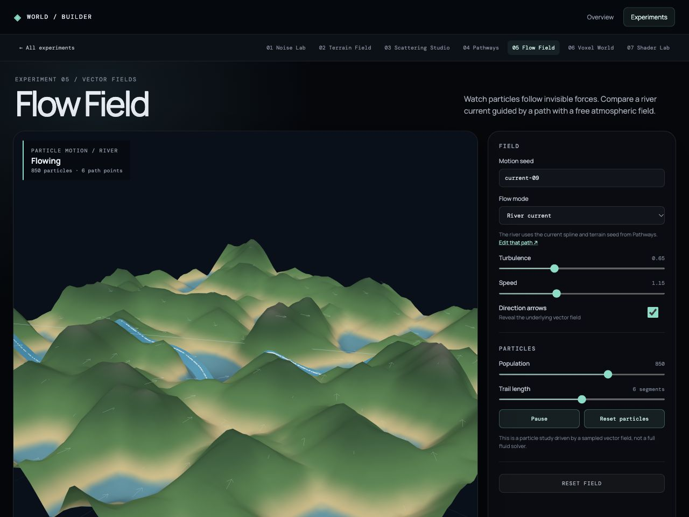

# Flow Field

Flow Field makes a vector field visible through particles and direction arrows. River mode follows the current Pathways spline, using its terrain seed and carved channel. Atmospheric mode combines a directional current with seeded curl-noise variation over the terrain.

The controls expose motion seed, turbulence, speed, particle population, trail length, and arrow visibility. Play/pause and particle reset let the viewer compare states. Particle positions and trail buffers update directly in the render loop; React state is reserved for user controls. The mode is a visual motion study rather than a physically accurate fluid solver.

The vector sampler and deterministic initialization are in [`createFlowField.js`](../../src/features/environment/createFlowField.js). Rendering and controls are in [`FlowFieldStudy.jsx`](../../src/features/environment/FlowFieldStudy.jsx). `npm run verify:environment` covers deterministic initialization and finite, normalized vectors.
