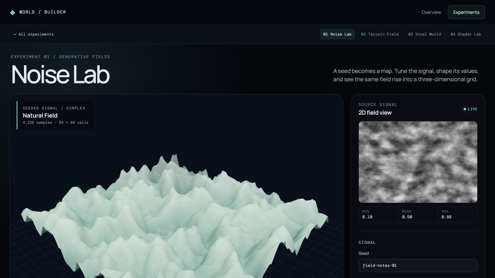

# Noise Lab

Noise Lab isolates the map-making step before the terrain system adds erosion, material zones, and tiled exploration. A seeded function produces a grayscale 2D field; the same samples displace a 3D grid. This makes the connection between numerical values and spatial form visible without pretending that this is the finished world.

Open `#experiments/noise` in the local app. Choose a coherent simplex, cellular-distance, or white-noise source; tune scale, octave count, falloff, and lacunarity; then apply natural, ridged, billow, terrace, or power shaping. Grid resolution and vertical relief change the geometry, while wireframe reveals its topology. The map and mesh update together.

The generator lives in [`src/features/noise/createNoiseStudyField.js`](../../src/features/noise/createNoiseStudyField.js), the view in [`src/features/noise/NoiseLab.jsx`](../../src/features/noise/NoiseLab.jsx). A seed and the same settings reproduce the same field. White noise is intentionally independent from point to point; the coherent and cellular sources blend multiple octaves.

Run `npm run verify:noise` for deterministic, normalization, source, shaping, and resolution checks. This study is a signal laboratory, not a second terrain generator: the production Terrain Field has its own bounded/streaming generation and optional erosion pipeline.
