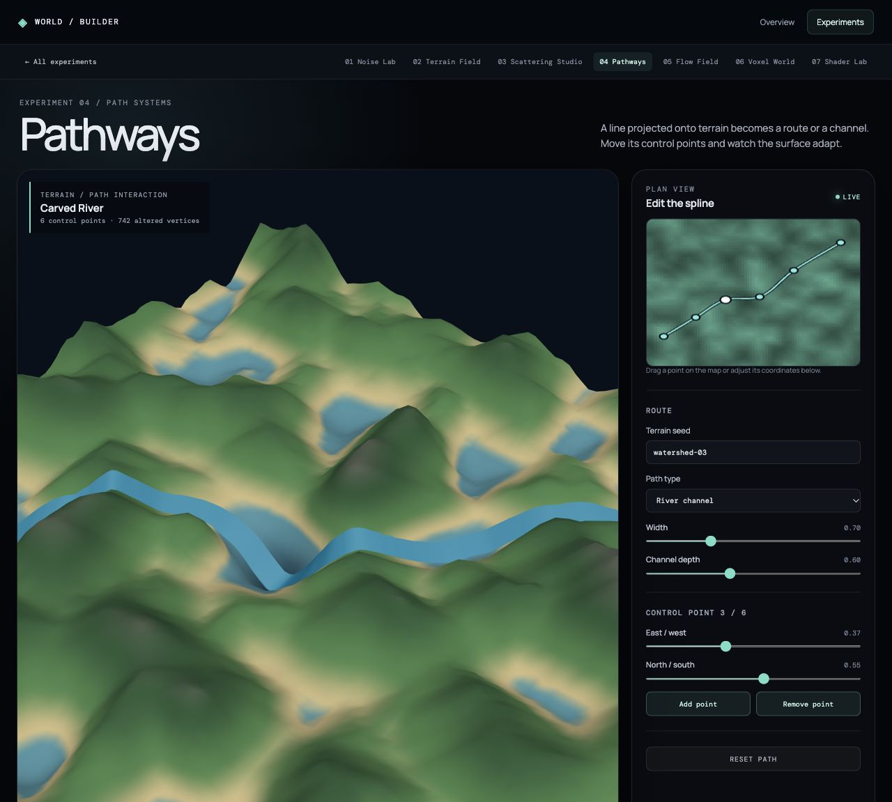

# Pathways

Pathways studies the relationship between a two-dimensional line and a three-dimensional terrain surface. Control points define a smooth spline. The line is projected onto the terrain and can form either a leveled road corridor or a carved river channel.

Drag control points on the plan-view map, select a point and adjust its coordinates, or add and remove points. Width changes the affected corridor; river mode also exposes channel depth. The underlying height field changes within a smooth falloff around the spline, and a surface ribbon makes the route visible. The readout reports how many terrain vertices were altered.

The spline sampling and deformation live in [`createPaths.js`](../../src/features/environment/createPaths.js). The interactive map and 3D ribbon live in [`PathwaysStudy.jsx`](../../src/features/environment/PathwaysStudy.jsx). Its current spline and terrain seed remain available to Flow Field while the app is open. This is an editable study, not yet a persistent world-building tool.
