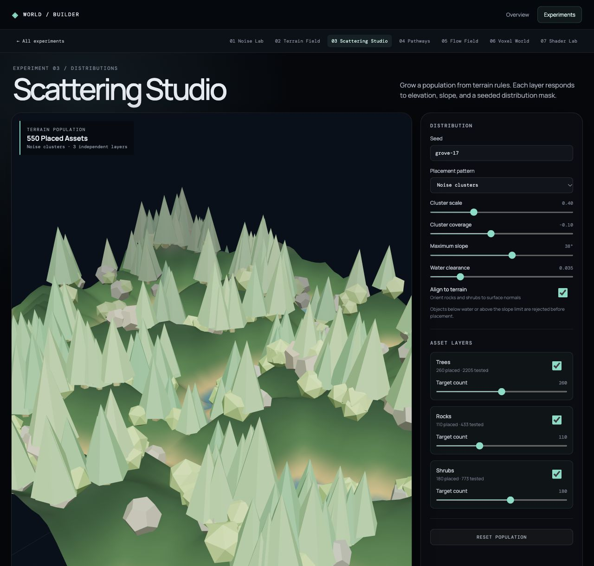

# Scattering Studio

Scattering Studio studies how terrain can govern the placement of repeated assets. A seed produces a terrain field and three independent populations: trees, rocks, and shrubs. Each candidate is sampled against local elevation and slope before being placed. A coherent mask can concentrate the population into clusters; switching to uniform random distribution makes the contrast visible.

Each layer has its own visibility and target count. Shared controls set maximum slope and minimum water clearance. Per-instance size, orientation, and color vary, with color partly influenced by the terrain value. The scene renders repeated assets with instanced meshes rather than a separate draw call per object.

The shared terrain query is [`terrainSampler.js`](../../src/features/environment/terrainSampler.js). Placement rules are in [`createScatter.js`](../../src/features/environment/createScatter.js), and the interactive view is [`ScatteringStudy.jsx`](../../src/features/environment/ScatteringStudy.jsx). A seed and the same controls reproduce the same placements. `npm run verify:environment` checks reproducibility and placement constraints.
