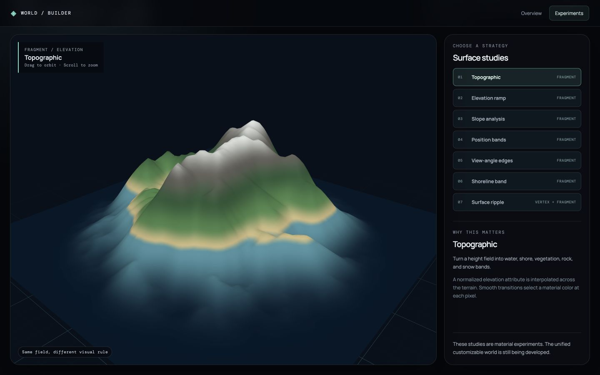
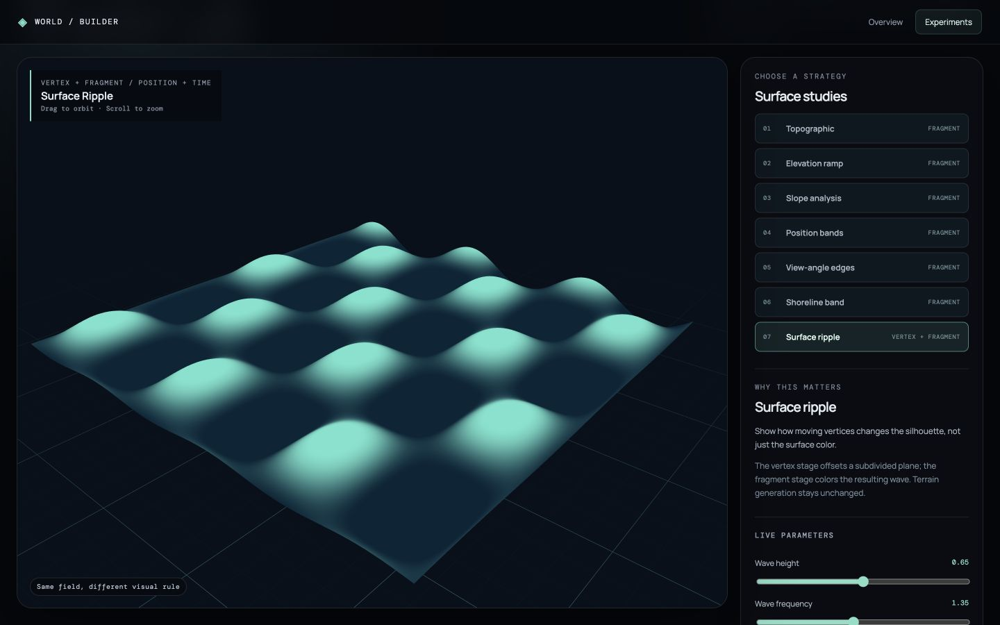

# Shader Lab

## Purpose

Explore how one generated form can communicate different information through its surface. The lab is the third secondary study in the portfolio. It reuses the Terrain Field generator and terrain mesh with its own fixed seed, while keeping visual strategy controls separate from terrain generation.

## Strategies

| View | Input to the shader | What it makes visible |
| --- | --- | --- |
| Topographic | Elevation | Water, shore, vegetation, rock, and snow bands |
| Elevation ramp | Elevation | Continuous height values |
| Slope analysis | World-space normal | Steep regions |
| Position bands | World X/Z | A scene-anchored spatial pattern |
| View-angle edges | Normal and camera position | Grazing-angle silhouettes |
| Shoreline band | Elevation, water level, and time | A stylized contact line near the water threshold |
| Surface ripple | Vertex position and time | Silhouette-changing displacement on a separate water surface |

## Interaction

Choose a strategy in the right panel, orbit the camera, and adjust the live parameter where one is available. The view-angle strategy is especially useful while orbiting. Motion can be paused for the shoreline and ripple views, and is off by default when the system requests reduced motion.

## Implementation

The terrain strategies share the existing [TerrainMesh shader](../../src/features/terrain/TerrainMesh.jsx). A mode uniform selects the fragment treatment while elevation, normal, and world position are passed from the vertex stage. [ShaderLab.jsx](../../src/features/shaders/ShaderLab.jsx) owns the selector, controls, shared seeded field, and a separate subdivided plane for the vertex-ripple demonstration. Changes to shader controls update uniforms rather than regenerating the field.

## Boundary and next use

The shoreline band is stylized visual contact, not fluid simulation. The ripple changes only the demonstration plane; it does not alter saved terrain data or the deterministic generator. The strongest strategies can later inform the unified world’s visual language, but that integration has not been built yet.
