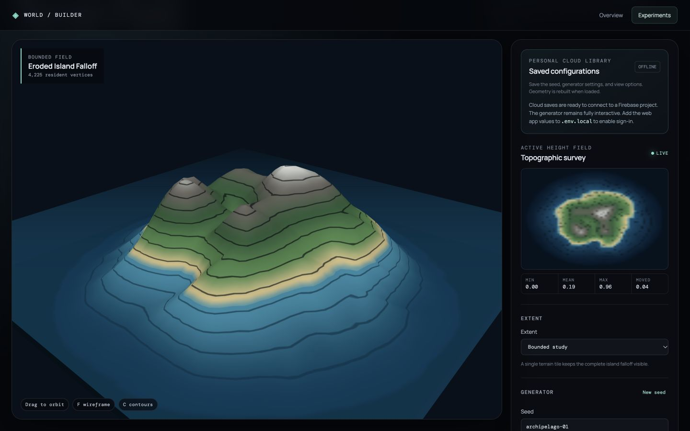

# Terrain Field

## Purpose

Test how a compact set of rules can generate and inspect an explorable height field. This is an independent study, not the completed customizable world.

## Method

1. A seed initializes coherent noise.
2. Octaves and shaping rules create the base elevation field.
3. Optional thermal erosion redistributes unstable height values.
4. The same field feeds a 2D survey and a Three.js terrain mesh.
5. The terrain material reads elevation and surface normals to display topographic, elevation, or slope views. A separate view can keep nine tiles resident around the camera target.

## What to try

- Change the seed, noise scale, or shaping operation to alter landform.
- Toggle erosion and compare the moved-material readout.
- Switch surface views and contours without regenerating noise.
- Change from a bounded island to streaming tiles and pan with WASD.

## Implementation and evidence

- [Field generation](../../src/features/terrain/generation/createNoiseField.js) and [cache](../../src/features/terrain/generation/terrainFieldCache.js)
- [3D material](../../src/features/terrain/TerrainMesh.jsx) and [world composition](../../src/features/terrain/TerrainWorld.jsx)
- [Generation design](../planning/procedural-terrain-milestone-1.md) and [simulation/streaming design](../planning/procedural-terrain-milestone-2.md)
- `npm run verify:terrain` checks deterministic generation and tiled continuity.

## Boundary

The height field represents one surface at each horizontal coordinate. It cannot model overhangs or caves; the [Voxel World](voxel-world.md) tests a volume representation for those forms.
