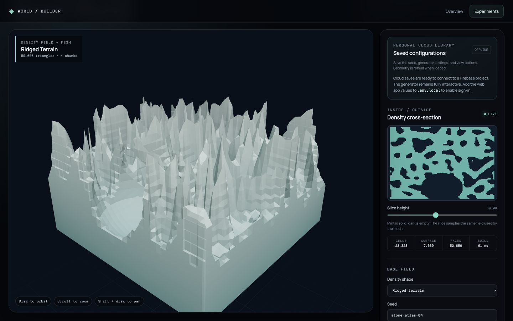

# Voxel World

## Purpose

Explore forms that a height field cannot express, including enclosed spaces, cutouts, and stacked mass. This is a bounded density-field study, not the finished world.

## Method

The selected base preset defines a signed density value throughout a three-dimensional volume. Ordered constructive-solid-geometry operations combine or remove sphere, box, and tunnel shapes. Four chunks sample the resulting field independently; marching tetrahedra emits triangles only where the density crosses zero. The cross-section samples that same field, making the inside/outside rule visible.

## What to try

- Change the base density preset and seed.
- Add, reorder, or disable overlapping shape operations.
- Move the cross-section through the volume.
- Compare mesh resolution, wireframe, and chunk bounds.

## Implementation and evidence

- [Density generation and meshing](../../src/features/voxel/generation/createVoxelWorld.js)
- [Interactive view](../../src/features/voxel/VoxelStudy.jsx)
- [Meshing decisions and limits](../planning/voxel-world-study.md)
- `npm run verify:voxel` checks determinism, operation order, finite vertices, and chunk seams.

## Boundary

The four-chunk volume is intentionally finite and generated on the main thread. It does not provide editable infinite streaming, physics, or a production-scale terrain pipeline.
