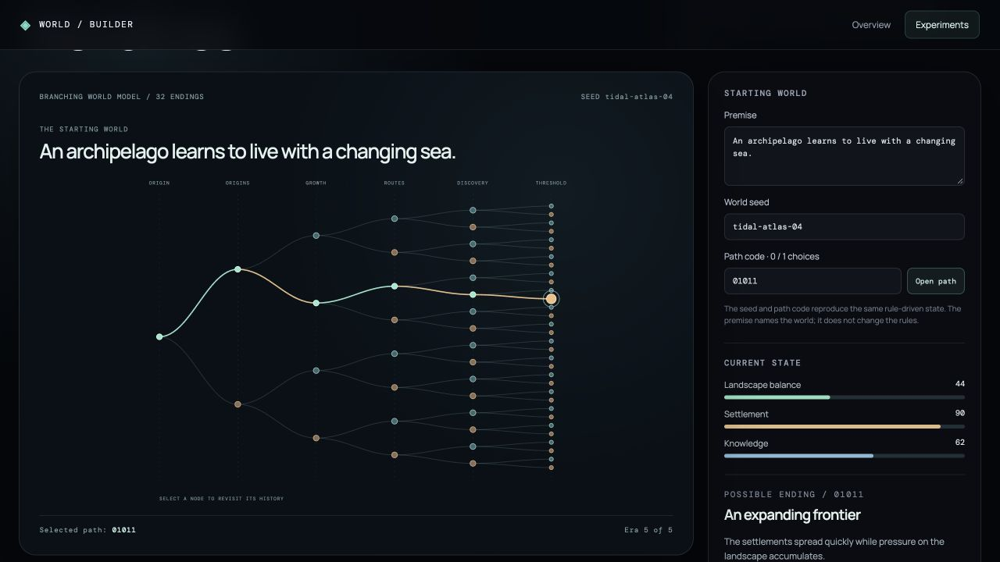

# Worldlines

Worldlines explores how one starting world can develop into many possible histories. Five authored decision stages form a branching graph with 32 reachable end states. Each choice changes landscape balance, settlement, and knowledge through explicit rules.

Select either decision at the current fork, click a node in the graph, or enter a path code to revisit a history. The current state and chronicle update with the selected path. The world seed introduces bounded variation to initial conditions and consequences; the same seed and path code reproduce the same numeric state and outcome. The editable premise names the world, but deliberately does not alter the rules.

The rule engine is [`createWorldlines.js`](../../src/features/worldlines/createWorldlines.js), and the browser interface is [`WorldlinesStudy.jsx`](../../src/features/worldlines/WorldlinesStudy.jsx). `npm run verify:branching` checks graph size, deterministic replay, state bounds, and valid parent links. This is a narrative-systems prototype, not the finished customizable world or a simulation of real societies.
