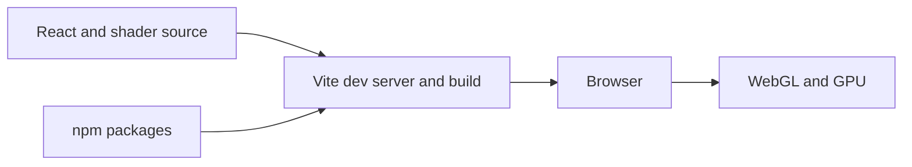

# Project setup: Node.js, npm, Vite, and the 3D stack

The browser runs the finished application. Node.js runs the development tools that install packages, transform JSX, serve files locally, and build production assets.



## 1. Verify Node.js and npm

```bash
node --version
npm --version
```

At the time this tutorial was written, Vite requires Node.js 20.19 or newer, or 22.12 or newer. Prefer an active LTS release. If `node` is not found, install Node.js from the official site and reopen the terminal.

## 2. Create the React application

For a new empty directory:

```bash
npm create vite@latest procedural-world -- --template react
cd procedural-world
npm install
```

To scaffold into the current empty directory, replace `procedural-world` with `.`.

Vite creates these scripts in `package.json`:

```bash
npm run dev      # local development server
npm run build    # optimized files in dist/
npm run preview  # serve the production build locally
```

## 3. Install the project libraries

```bash
npm install three @react-three/fiber @react-three/drei
npm install leva simplex-noise firebase
```

| Package | Responsibility |
| --- | --- |
| `three` | Geometry, cameras, lights, materials, textures, and WebGL rendering |
| `@react-three/fiber` | React renderer for Three.js |
| `@react-three/drei` | Useful scene helpers such as `OrbitControls` and `Grid` |
| `leva` | Live sliders, color pickers, toggles, and debug controls |
| `simplex-noise` | Coherent noise for terrain generation |
| `firebase` | Optional remote persistence and authentication |

## 4. Replace the starter screen

Create `src/app/App.jsx`:

```jsx
import { Canvas } from '@react-three/fiber'
import { OrbitControls } from '@react-three/drei'

export default function App() {
  return (
    <main className="app">
      <Canvas camera={{ position: [4, 3, 6], fov: 50 }}>
        <color attach="background" args={['#10141c']} />
        <ambientLight intensity={0.5} />
        <directionalLight position={[4, 6, 3]} intensity={2} />

        <mesh>
          <icosahedronGeometry args={[1.4, 3]} />
          <meshStandardMaterial color="#64c987" roughness={0.75} />
        </mesh>

        <OrbitControls makeDefault />
      </Canvas>
    </main>
  )
}
```

Update `src/main.jsx`:

```jsx
import { StrictMode } from 'react'
import { createRoot } from 'react-dom/client'
import App from './app/App.jsx'
import './styles.css'

createRoot(document.getElementById('root')).render(
  <StrictMode>
    <App />
  </StrictMode>,
)
```

Create `src/styles.css`:

```css
:root {
  font-family: Inter, system-ui, sans-serif;
  color: #eef2f6;
  background: #10141c;
}

* { box-sizing: border-box; }
html, body, #root { width: 100%; height: 100%; margin: 0; }
.app { width: 100%; height: 100%; }
canvas { display: block; }
```

Run the project:

```bash
npm run dev
```

You should see a shaded icosahedron that you can rotate and zoom around.

## 5. Environment variables

Vite exposes only variables whose names begin with `VITE_`:

```dotenv
VITE_FIREBASE_API_KEY=...
VITE_FIREBASE_PROJECT_ID=...
```

Read them with `import.meta.env.VITE_FIREBASE_PROJECT_ID`. Client-side Firebase configuration identifies a project; it does not replace Firestore Security Rules. Never put an Admin SDK private key or other server secret in a Vite environment variable.

Add local environment files to `.gitignore`:

```gitignore
.env.local
.env.*.local
```

## Common problems

- **Blank page:** inspect the browser console for an import or JSX error.
- **Canvas has zero height:** give `html`, `body`, `#root`, and the canvas container a height.
- **`npm` cannot resolve dependencies:** confirm that React, Three.js, and React Three Fiber use compatible major versions; avoid forcing an install until you understand the conflict.
- **A second animation appears in development:** React Strict Mode intentionally checks mount behavior. Clean up timers, listeners, and raw Three.js resources in effect cleanup functions.

## Checkpoint

- [ ] `npm run dev` opens the app without console errors.
- [ ] Dragging rotates the view and scrolling zooms.
- [ ] `npm run build` completes successfully.

## Official references

- [Vite: Getting Started](https://vite.dev/guide/)
- [Node.js downloads](https://nodejs.org/en/download)
- [React Three Fiber: Introduction](https://r3f.docs.pmnd.rs/getting-started/introduction)
- [Drei controls](https://drei.docs.pmnd.rs/controls/introduction)
