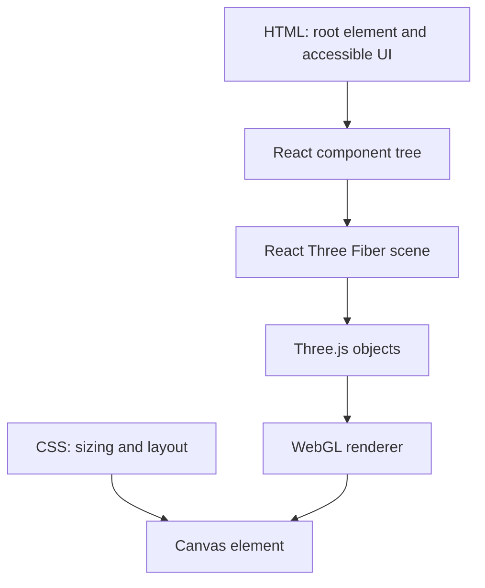

# Web and React foundations for a 3D application

A React Three Fiber application still uses the normal browser platform. HTML provides document structure, CSS controls the page around the canvas, JavaScript runs application logic, and WebGL renders the scene into a `<canvas>` element.

## Browser layers



If the canvas is full-screen, HTML and CSS still matter. They decide whether the canvas has dimensions, whether an overlay intercepts pointer events, and how control panels respond on smaller screens.

## Components describe structure

```jsx
function Rock({ position, color = '#87937f' }) {
  return (
    <mesh position={position} castShadow>
      <dodecahedronGeometry args={[0.5, 0]} />
      <meshStandardMaterial color={color} roughness={0.9} />
    </mesh>
  )
}

export function RockField() {
  return (
    <group>
      <Rock position={[-1, 0.5, 0]} />
      <Rock position={[0.3, 0.5, -1]} color="#697963" />
      <Rock position={[1.4, 0.5, 0.5]} />
    </group>
  )
}
```

Props describe differences between instances. Keep components focused: `Rock` owns one object, while `RockField` owns their arrangement.

## State stores values that affect rendering

```jsx
import { useState } from 'react'

function DebugToggle({ children }) {
  const [wireframe, setWireframe] = useState(false)

  return (
    <>
      <button className="debug-button" onClick={() => setWireframe(v => !v)}>
        Wireframe: {wireframe ? 'on' : 'off'}
      </button>
      {children(wireframe)}
    </>
  )
}
```

Use state for information that changes what React should render: selected seed, active biome, edit mode, or whether a debug overlay is visible.

## Refs hold mutable scene objects

A ref survives re-renders without triggering a new render when its `.current` value changes.

```jsx
import { useRef } from 'react'
import { useFrame } from '@react-three/fiber'

function RotatingMarker() {
  const meshRef = useRef()

  useFrame((state, delta) => {
    meshRef.current.rotation.y += delta * 0.4
  })

  return (
    <mesh ref={meshRef} position={[0, 1, 0]}>
      <coneGeometry args={[0.3, 0.8, 8]} />
      <meshStandardMaterial color="orange" />
    </mesh>
  )
}
```

Changing React state 60 times per second would repeatedly reconcile the component tree. A ref is better for continuous transforms, camera targets, and other frame-by-frame values that do not need to update HTML.

## Effects synchronize with systems outside React

Use an effect for subscriptions, browser APIs, or an imperative library connection:

```jsx
import { useEffect } from 'react'

function KeyboardShortcuts({ onRegenerate }) {
  useEffect(() => {
    function onKeyDown(event) {
      if (event.key.toLowerCase() === 'r') onRegenerate()
    }

    window.addEventListener('keydown', onKeyDown)
    return () => window.removeEventListener('keydown', onKeyDown)
  }, [onRegenerate])

  return null
}
```

The cleanup prevents duplicate listeners after remounting. Do not use an effect just to calculate a value from props; calculate it during rendering or memoize expensive work.

## Memoize expensive generation

Terrain generation can allocate thousands of vertices. Recalculate only when its inputs change:

```jsx
import { useMemo } from 'react'

function Terrain({ seed, resolution, frequency }) {
  const heightField = useMemo(
    () => createHeightField({ seed, resolution, frequency }),
    [seed, resolution, frequency],
  )

  return <TerrainMesh heightField={heightField} />
}
```

`useMemo` is a performance tool. The calculation must remain correct if React recalculates it.

## Choose the right storage mechanism

| Value | Best home | Reason |
| --- | --- | --- |
| Selected world seed | State | UI and scene both display it |
| Mesh reference | Ref | Mutable object, no UI render required |
| Height field derived from parameters | Memoized value | Expensive but reproducible |
| Saved world from Firestore | State or query cache | Arrives asynchronously and affects UI |
| Constant biome thresholds | Module constant | Does not vary by component instance |

## Exercise

Create a `WorldPreview` component with:

- a stateful wireframe toggle;
- a rotating marker animated through a ref;
- a memoized list of object positions generated from a seed;
- cleanup for an `R` keyboard shortcut that regenerates the seed.

## Official references

- [React: State as a component's memory](https://react.dev/learn/state-a-components-memory)
- [React: Referencing values with refs](https://react.dev/learn/referencing-values-with-refs)
- [React: Synchronizing with effects](https://react.dev/learn/synchronizing-with-effects)
- [React: Built-in hooks](https://react.dev/reference/react/hooks)
