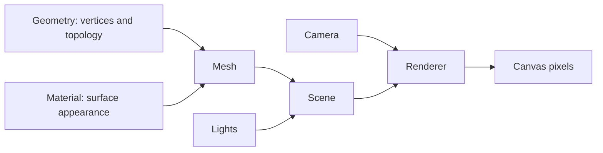

# Three.js scene fundamentals

Every visible object results from the same core relationship: a renderer draws a scene from a camera's point of view.



React Three Fiber creates and maintains these Three.js objects, but the underlying concepts stay the same.

## Scene, camera, and renderer

This is the raw Three.js form of the pipeline:

```js
import * as THREE from 'three'
import { OrbitControls } from 'three/addons/controls/OrbitControls.js'

const scene = new THREE.Scene()
scene.background = new THREE.Color('#10141c')

const camera = new THREE.PerspectiveCamera(50, innerWidth / innerHeight, 0.1, 200)
camera.position.set(4, 3, 6)

const renderer = new THREE.WebGLRenderer({ antialias: true })
renderer.setSize(innerWidth, innerHeight)
renderer.setPixelRatio(Math.min(devicePixelRatio, 2))
document.body.appendChild(renderer.domElement)

const controls = new OrbitControls(camera, renderer.domElement)
controls.enableDamping = true

renderer.setAnimationLoop(() => {
  controls.update()
  renderer.render(scene, camera)
})
```

The camera near and far values define the visible depth range. A huge ratio between them reduces depth-buffer precision and can cause flickering surfaces.

## Geometry and topology

Geometry stores vertex attributes such as position, normal, color, and UV coordinates. An index can specify which vertices form each triangle.

```js
const positions = new Float32Array([
  -1, 0, -1,
   1, 0, -1,
   1, 0,  1,
  -1, 0,  1,
])

const geometry = new THREE.BufferGeometry()
geometry.setAttribute('position', new THREE.BufferAttribute(positions, 3))
geometry.setIndex([0, 1, 2, 0, 2, 3])
geometry.computeVertexNormals()
```

The index `[0, 1, 2, 0, 2, 3]` creates two triangles from four shared vertices. This connectivity is the mesh topology.

Use wireframe mode to inspect it:

```js
const material = new THREE.MeshStandardMaterial({
  color: '#6a9f63',
  wireframe: true,
})
```

Wireframe is an excellent topology diagnostic, but it is not a complete edge-rendering system. It exposes triangle edges, including internal diagonals.

## Normals and light

Normals describe the direction a surface faces. Lighting materials use normals to calculate brightness. After changing vertex positions, recompute them:

```js
const positions = geometry.attributes.position
positions.setY(12, 1.75)
positions.needsUpdate = true
geometry.computeVertexNormals()
geometry.computeBoundingSphere()
```

Common lights:

- `AmbientLight` adds the same amount everywhere and cannot cast shadows.
- `HemisphereLight` blends sky and ground colors.
- `DirectionalLight` behaves like a distant source such as the sun.
- `PointLight` radiates from a position.

A useful outdoor starting point is a hemisphere light plus one directional light.

## Materials

| Material | React Three Fiber element | Use |
| --- | --- | --- |
| Basic | `<meshBasicMaterial>` | Unlit debug colors, icons, and helpers |
| Lambert | `<meshLambertMaterial>` | Inexpensive matte lighting |
| Phong | `<meshPhongMaterial>` | Classic highlights and simple shiny surfaces |
| Standard | `<meshStandardMaterial>` | Physically based default for most world surfaces |
| Shader | `<shaderMaterial>` | Fully custom vertex and fragment programs |

`MeshBasicMaterial` ignores lights. If adding a light has no visible effect, inspect the material first.

## A complete React Three Fiber scene

```jsx
import { Canvas } from '@react-three/fiber'
import { Grid, OrbitControls } from '@react-three/drei'

export function WorldCanvas() {
  return (
    <Canvas shadows camera={{ position: [6, 5, 7], fov: 45, near: 0.1, far: 150 }}>
      <color attach="background" args={['#0e1420']} />
      <fog attach="fog" args={['#0e1420', 18, 55]} />

      <hemisphereLight args={['#cfe8ff', '#1c241b', 1.1]} />
      <directionalLight
        castShadow
        position={[8, 12, 5]}
        intensity={2.5}
        shadow-mapSize={[2048, 2048]}
      />

      <mesh castShadow receiveShadow position={[0, 1, 0]}>
        <icosahedronGeometry args={[1.5, 4]} />
        <meshStandardMaterial color="#58a86a" roughness={0.82} />
      </mesh>

      <Grid
        args={[80, 80]}
        cellSize={1}
        sectionSize={5}
        fadeDistance={45}
        fadeStrength={1}
        infiniteGrid
      />

      <OrbitControls makeDefault enableDamping />
    </Canvas>
  )
}
```

The grid fade and fog both reduce the hard visual boundary of the world. Keep their distances coordinated.

## Camera controls

Orbit controls orbit around a target, pan, and dolly. Set the target near the subject:

```jsx
<OrbitControls target={[0, 1, 0]} minDistance={3} maxDistance={30} />
```

For an editor, orbit controls are a good default. A walking experience usually needs pointer-lock or custom character controls instead.

## Performance checks

- Cap pixel ratio rather than rendering an unrestricted high-density display.
- Reuse geometry and materials for repeated objects.
- Prefer instancing for hundreds of similar trees or rocks.
- Avoid enabling shadows on every light and object.
- Change terrain resolution deliberately; doubling both grid dimensions creates about four times as many vertices.

## Exercise

Create a scene that contains a sphere, box, and terrain plane. Add:

1. an orbit camera;
2. hemisphere and directional lighting;
3. shadows;
4. fog and a fading infinite grid;
5. a wireframe toggle for the terrain.

## Official references

- [Three.js fundamentals](https://threejs.org/manual/#en/fundamentals)
- [BufferGeometry](https://threejs.org/docs/#api/en/core/BufferGeometry)
- [OrbitControls](https://threejs.org/docs/#examples/en/controls/OrbitControls)
- [Three.js materials](https://threejs.org/manual/#en/materials)
