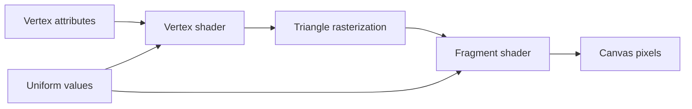

# Materials and shaders

Geometry defines where a surface exists. A material defines how the renderer turns that surface into pixels.

## Choose a material by its lighting model

```jsx
function MaterialExamples() {
  return (
    <>
      <mesh position={[-2.4, 0, 0]}>
        <sphereGeometry />
        <meshBasicMaterial color="#d95c50" />
      </mesh>

      <mesh position={[0, 0, 0]}>
        <sphereGeometry />
        <meshLambertMaterial color="#d95c50" />
      </mesh>

      <mesh position={[2.4, 0, 0]}>
        <sphereGeometry />
        <meshStandardMaterial color="#d95c50" roughness={0.35} metalness={0.05} />
      </mesh>
    </>
  )
}
```

- Basic material displays a flat color and ignores lights.
- Lambert material gives inexpensive diffuse shading.
- Phong material adds classic specular highlights.
- Standard material uses a physically based roughness/metalness workflow.

For terrain, start with `MeshStandardMaterial`. Move to a custom shader only when a built-in material cannot express the visual rule you need. The portfolio's current [TerrainMesh](../../src/features/terrain/TerrainMesh.jsx) uses a custom shader for analytical surface views; [Shader Lab](../studies/shader-lab.md) compares additional strategies.

## The programmable pipeline



The vertex shader runs for vertices and writes clip-space positions. The fragment shader runs for candidate pixels and writes colors. Uniforms are values shared across a draw call, such as elapsed time, terrain colors, or a water level.

## An animated shader material

The following is a standalone teaching example, not a file that already exists in this repository. Create `src/features/world/materials/TerrainShaderMaterial.jsx` in a fresh practice project:

```jsx
import { forwardRef } from 'react'
import { shaderMaterial } from '@react-three/drei'
import { extend } from '@react-three/fiber'
import * as THREE from 'three'

const TerrainShader = shaderMaterial(
  {
    uTime: 0,
    uLowColor: new THREE.Color('#243b2e'),
    uHighColor: new THREE.Color('#b8d47a'),
  },
  /* glsl */ `
    uniform float uTime;
    varying float vHeight;
    varying vec3 vNormalWorld;

    void main() {
      vec3 displaced = position;
      displaced += normal * sin(uTime * 0.7 + position.y * 4.0) * 0.025;

      vec4 worldPosition = modelMatrix * vec4(displaced, 1.0);
      vHeight = worldPosition.y;
      vNormalWorld = normalize(mat3(modelMatrix) * normal);

      gl_Position = projectionMatrix * viewMatrix * worldPosition;
    }
  `,
  /* glsl */ `
    uniform vec3 uLowColor;
    uniform vec3 uHighColor;
    varying float vHeight;
    varying vec3 vNormalWorld;

    void main() {
      float heightMix = smoothstep(-0.2, 2.5, vHeight);
      vec3 base = mix(uLowColor, uHighColor, heightMix);

      vec3 lightDirection = normalize(vec3(0.5, 1.0, 0.35));
      float diffuse = max(dot(normalize(vNormalWorld), lightDirection), 0.0);
      vec3 color = base * (0.35 + diffuse * 0.75);

      gl_FragColor = vec4(color, 1.0);
    }
  `,
)

extend({ TerrainShader })

export const TerrainShaderMaterial = forwardRef(function TerrainShaderMaterial(props, ref) {
  return <terrainShader ref={ref} {...props} />
})
```

The `shaderMaterial` helper creates uniform setters and a material class. `extend` makes that class available to the React Three Fiber renderer.

Use it in a mesh:

```jsx
import { useRef } from 'react'
import { useFrame } from '@react-three/fiber'
import { TerrainShaderMaterial } from './materials/TerrainShaderMaterial.jsx'

function ShaderTerrain({ geometry }) {
  const material = useRef()

  useFrame(({ clock }) => {
    material.current.uTime = clock.elapsedTime
  })

  return (
    <mesh geometry={geometry} receiveShadow>
      <TerrainShaderMaterial ref={material} />
    </mesh>
  )
}
```

## Attributes, uniforms, and varyings

| Data | Changes | Typical use |
| --- | --- | --- |
| Attribute | Per vertex | position, normal, UV, biome weight |
| Uniform | Per draw call | time, seed, colors, water level |
| Varying | Interpolated across a triangle | data passed from vertex to fragment shader |

If every terrain vertex needs a biome value, add a buffer attribute. If the whole terrain shares one snow height, use a uniform.

## Height-based biome color

A fragment shader can blend colors without storing a color for every vertex:

```glsl
vec3 sand = vec3(0.72, 0.64, 0.43);
vec3 grass = vec3(0.24, 0.48, 0.24);
vec3 rock = vec3(0.38, 0.39, 0.37);

float beach = smoothstep(uWaterLevel, uWaterLevel + 0.12, vHeight);
float mountain = smoothstep(uRockLevel, uRockLevel + 0.35, vHeight);

vec3 land = mix(sand, grass, beach);
vec3 color = mix(land, rock, mountain);
```

Use `smoothstep` around thresholds to prevent hard color bands.

## Shader debugging

- Start with a constant fragment color. Add calculations one at a time.
- Visualize a normal with `normal * 0.5 + 0.5`.
- Visualize a scalar as grayscale: `vec3(value)`.
- Check shader compilation messages in the browser console.
- Keep coordinate spaces explicit. Do not compare an object-space height with a world-space water level.
- Clamp or remap values before using them as colors.

## Cleanup and performance

- Update existing uniform values rather than constructing a new material every frame.
- Avoid shader recompilation caused by frequently changing `#define` values.
- Keep the number of material variants under control; each variant may require another GPU program.
- Prefer uniforms for live controls.

## Try it

Extend the terrain shader with:

1. a water, grass, and rock color ramp;
2. a `uWaterLevel` uniform;
3. a gentle time-based displacement;
4. a normal-based slope mask that exposes rock on steep surfaces.

## Official references

- [Three.js materials](https://threejs.org/manual/#en/materials)
- [ShaderMaterial](https://threejs.org/docs/#api/en/materials/ShaderMaterial)
- [WebGL program parameters](https://threejs.org/docs/#api/en/renderers/webgl/WebGLProgram)
- [Drei shaderMaterial](https://drei.docs.pmnd.rs/shaders/shader-material)
