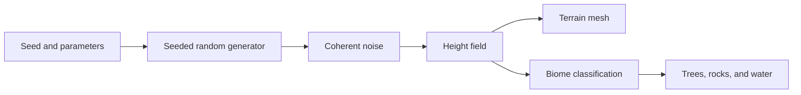

# Procedural world generation

Procedural generation turns a compact configuration into repeatable content. A useful generator is deterministic: the same seed and parameters produce the same result.



## Randomness versus coherent noise

Independent random samples look like static. Terrain needs nearby points to be related. Coherent noise returns similar values at nearby coordinates while still changing over larger distances.

Combine several frequencies to add broad landforms and small detail:

```text
height = octave₀ + 0.5 × octave₁ + 0.25 × octave₂ + ...
```

This technique is often called fractal Brownian motion, or fBm.

## A deterministic seed

Create `src/features/world/generation/createHeightField.js`:

```js
import { createNoise2D } from 'simplex-noise'

function hashSeed(seed) {
  const text = String(seed)
  let hash = 2166136261

  for (let i = 0; i < text.length; i += 1) {
    hash ^= text.charCodeAt(i)
    hash = Math.imul(hash, 16777619)
  }

  return hash >>> 0
}

function mulberry32(seed) {
  return function random() {
    let value = seed += 0x6d2b79f5
    value = Math.imul(value ^ (value >>> 15), value | 1)
    value ^= value + Math.imul(value ^ (value >>> 7), value | 61)
    return ((value ^ (value >>> 14)) >>> 0) / 4294967296
  }
}

function fbm(noise2D, x, y, octaves, persistence, lacunarity) {
  let value = 0
  let amplitude = 1
  let frequency = 1
  let amplitudeTotal = 0

  for (let octave = 0; octave < octaves; octave += 1) {
    value += noise2D(x * frequency, y * frequency) * amplitude
    amplitudeTotal += amplitude
    amplitude *= persistence
    frequency *= lacunarity
  }

  return value / amplitudeTotal
}

export function createHeightField({
  seed,
  resolution = 128,
  size = 24,
  frequency = 0.08,
  amplitude = 4,
  octaves = 5,
  persistence = 0.5,
  lacunarity = 2,
}) {
  const random = mulberry32(hashSeed(seed))
  const noise2D = createNoise2D(random)
  const values = new Float32Array((resolution + 1) ** 2)

  for (let row = 0; row <= resolution; row += 1) {
    for (let column = 0; column <= resolution; column += 1) {
      const index = row * (resolution + 1) + column
      const x = (column / resolution - 0.5) * size
      const z = (row / resolution - 0.5) * size
      const distance = Math.hypot(x, z) / (size * 0.5)
      const islandMask = Math.max(0, 1 - distance ** 2)
      const noise = fbm(noise2D, x * frequency, z * frequency, octaves, persistence, lacunarity)

      values[index] = noise * amplitude * islandMask - (1 - islandMask) * 0.8
    }
  }

  return { values, resolution, size }
}
```

The seeded pseudo-random generator initializes the noise permutation. Do not call `Math.random()` anywhere that must reproduce the world.

## Convert the height field into geometry

```jsx
import { useEffect, useMemo } from 'react'
import * as THREE from 'three'
import { createHeightField } from './generation/createHeightField.js'

export function Terrain({ config, wireframe = false }) {
  const geometry = useMemo(() => {
    const field = createHeightField(config)
    const result = new THREE.PlaneGeometry(
      field.size,
      field.size,
      field.resolution,
      field.resolution,
    )
    const positions = result.attributes.position

    for (let index = 0; index < positions.count; index += 1) {
      positions.setZ(index, field.values[index])
    }

    positions.needsUpdate = true
    result.computeVertexNormals()
    result.computeBoundingBox()
    result.computeBoundingSphere()
    return result
  }, [config])

  useEffect(() => () => geometry.dispose(), [geometry])

  return (
    <mesh geometry={geometry} rotation-x={-Math.PI / 2} receiveShadow castShadow>
      <meshStandardMaterial color="#5f8c57" roughness={0.9} wireframe={wireframe} />
    </mesh>
  )
}
```

Pass a stable, memoized `config` object. If a parent creates a new object literal every render, the terrain will regenerate every render.

## Biomes are classification rules

Start with height and slope:

```js
export function classifyBiome({ height, slope, waterLevel, snowLevel }) {
  if (height < waterLevel) return 'water'
  if (height < waterLevel + 0.2) return 'beach'
  if (height > snowLevel) return 'snow'
  if (slope > 0.62) return 'rock'
  return 'grass'
}
```

Later, add temperature and moisture noise. Keep classification independent from rendering so you can test it without a GPU.

## Place objects deterministically

For each candidate location:

1. Sample terrain height and biome.
2. Reject water and excessive slope.
3. Use a seeded probability test for density.
4. Derive rotation and scale from the same seeded generator.
5. Store a stable ID based on the grid cell or generator sequence.

Render large populations with instancing. Do not create thousands of individual React components if the objects share geometry and material.

## Chunking

A large or endless world should not be one enormous mesh.

```text
world position → chunk coordinate → chunk seed → generated chunk
```

Derive each chunk seed from the world seed and integer chunk coordinates. Load chunks within a radius of the camera and recycle or dispose chunks that move outside it.

Avoid visible seams by sampling noise in world coordinates. If every chunk restarts its noise coordinates at zero, borders will not match.

## Generation versioning

An algorithm change can alter every saved world even if its seed stays the same. Save a version with the configuration:

```js
const worldConfig = {
  generatorVersion: 1,
  seed: 'class-02-demo',
  terrain: {
    size: 24,
    resolution: 128,
    frequency: 0.08,
    amplitude: 4,
    octaves: 5,
  },
}
```

When you release a new generator, either migrate old configurations or preserve the old generator for existing worlds.

## Performance strategy

- Generate lower-resolution terrain while a slider is moving, then refine it when editing ends.
- Move expensive generation to a Web Worker if it blocks input.
- Reuse typed arrays where possible.
- Cache chunks by seed and coordinate.
- Use level of detail for distant terrain.
- Save parameters, not generated vertex arrays, unless exact baked geometry is a requirement.

## Exercise

Generate an island with two additional controls:

- `ridgeStrength`, which sharpens mountains by transforming the noise value;
- `waterLevel`, which affects both biome classification and the water plane.

Verify that reloading the page with the same configuration produces the same topology and object placements.

## References

- [simplex-noise project documentation](https://github.com/jwagner/simplex-noise.js)
- [Three.js BufferGeometry](https://threejs.org/docs/#api/en/core/BufferGeometry)
- [Three.js instanced mesh](https://threejs.org/docs/#api/en/objects/InstancedMesh)
