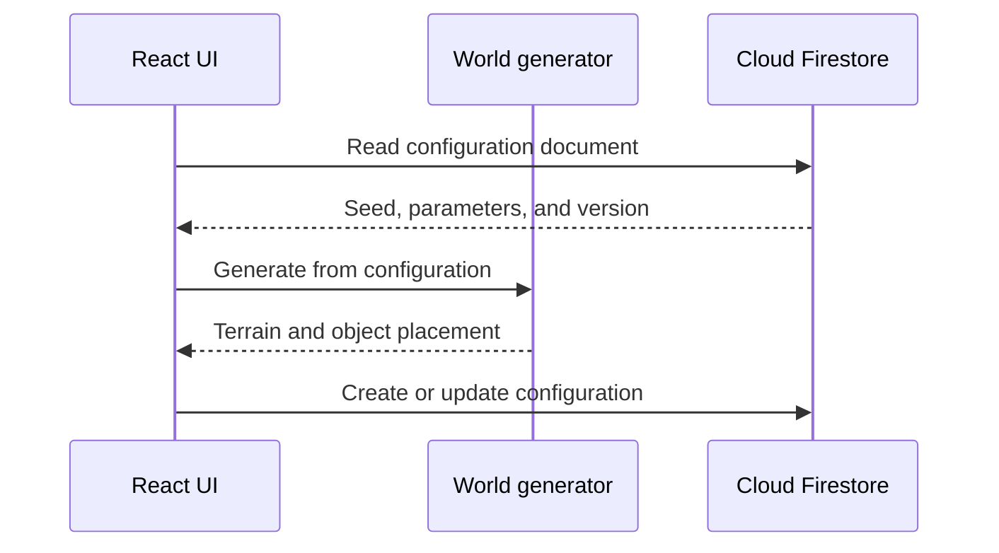

# Firebase CRUD and world persistence

Firebase is a backend-as-a-service platform. For this project, Cloud Firestore can store world configuration documents while Firebase Authentication identifies their owners.



The database should usually store the inputs to generation, not millions of generated vertices.

## 1. Create and register the Firebase app

In the Firebase console:

1. Create or select a project.
2. Register a Web app.
3. Create a Cloud Firestore database.
4. Enable an Authentication provider before allowing user-owned writes.

Install the modular web SDK:

```bash
npm install firebase
```

Create `.env.local`:

```dotenv
VITE_FIREBASE_API_KEY=replace-me
VITE_FIREBASE_AUTH_DOMAIN=replace-me.firebaseapp.com
VITE_FIREBASE_PROJECT_ID=replace-me
VITE_FIREBASE_STORAGE_BUCKET=replace-me.firebasestorage.app
VITE_FIREBASE_MESSAGING_SENDER_ID=replace-me
VITE_FIREBASE_APP_ID=replace-me
```

Firebase web configuration is visible to browser users by design. Security comes from Authentication, Security Rules, App Check where appropriate, and restricted Google Cloud API keys. Never ship Admin SDK credentials to a browser.

## 2. Initialize Firebase once

Create `src/lib/firebase.js`:

```js
import { initializeApp } from 'firebase/app'
import { getAuth } from 'firebase/auth'
import { getFirestore } from 'firebase/firestore'

const firebaseConfig = {
  apiKey: import.meta.env.VITE_FIREBASE_API_KEY,
  authDomain: import.meta.env.VITE_FIREBASE_AUTH_DOMAIN,
  projectId: import.meta.env.VITE_FIREBASE_PROJECT_ID,
  storageBucket: import.meta.env.VITE_FIREBASE_STORAGE_BUCKET,
  messagingSenderId: import.meta.env.VITE_FIREBASE_MESSAGING_SENDER_ID,
  appId: import.meta.env.VITE_FIREBASE_APP_ID,
}

const app = initializeApp(firebaseConfig)

export const auth = getAuth(app)
export const db = getFirestore(app)
```

## 3. Design the document

```js
const worldDocument = {
  name: 'Mountain study',
  ownerId: 'firebase-user-id',
  generatorVersion: 1,
  seed: 'archipelago-01',
  terrain: {
    size: 24,
    resolution: 128,
    frequency: 0.08,
    amplitude: 4,
    octaves: 5,
    waterLevel: 0,
  },
  palette: {
    low: '#243b2e',
    high: '#b8d47a',
  },
}
```

Keep field names stable and validate ranges before generating. Firestore documents have size limits, another reason not to store raw terrain meshes.

## 4. Create

Create `src/features/world/worldRepository.js`:

```js
import {
  addDoc,
  collection,
  deleteDoc,
  doc,
  getDoc,
  getDocs,
  orderBy,
  query,
  serverTimestamp,
  updateDoc,
  where,
} from 'firebase/firestore'
import { db } from '../../lib/firebase.js'

const worlds = collection(db, 'worlds')

export async function createWorld(userId, world) {
  const reference = await addDoc(worlds, {
    ...world,
    ownerId: userId,
    createdAt: serverTimestamp(),
    updatedAt: serverTimestamp(),
  })

  return reference.id
}
```

## 5. Read one document

```js
export async function getWorld(worldId) {
  const snapshot = await getDoc(doc(db, 'worlds', worldId))

  if (!snapshot.exists()) return null
  return { id: snapshot.id, ...snapshot.data() }
}
```

## 6. Read a user's worlds

```js
export async function getWorldsForUser(userId) {
  const request = query(
    worlds,
    where('ownerId', '==', userId),
    orderBy('updatedAt', 'desc'),
  )
  const snapshot = await getDocs(request)
  return snapshot.docs.map(item => ({ id: item.id, ...item.data() }))
}
```

Firestore may prompt you to create a composite index for this combination of filtering and ordering. Follow the generated console link and keep index configuration under version control when the project matures.

## 7. Update

```js
export async function updateWorld(worldId, patch) {
  await updateDoc(doc(db, 'worlds', worldId), {
    ...patch,
    updatedAt: serverTimestamp(),
  })
}
```

Send an allowlisted patch from the UI. Do not spread an arbitrary request body into a document in a server environment.

## 8. Delete

```js
export async function deleteWorld(worldId) {
  await deleteDoc(doc(db, 'worlds', worldId))
}
```

Deletion is irreversible in the client workflow. Ask for confirmation in the UI and consider soft deletion if recovery matters.

## 9. Subscribe to live changes

```js
import { doc, onSnapshot } from 'firebase/firestore'
import { db } from '../../lib/firebase.js'

export function subscribeToWorld(worldId, onValue, onError) {
  return onSnapshot(
    doc(db, 'worlds', worldId),
    snapshot => {
      onValue(snapshot.exists() ? { id: snapshot.id, ...snapshot.data() } : null)
    },
    onError,
  )
}
```

Call the returned unsubscribe function in React effect cleanup.

## 10. Security Rules

Client code is not an authorization boundary. Start with owner-based rules:

```text
rules_version = '2';
service cloud.firestore {
  match /databases/{database}/documents {
    match /worlds/{worldId} {
      function signedIn() {
        return request.auth != null;
      }

      function ownsExistingWorld() {
        return signedIn() && resource.data.ownerId == request.auth.uid;
      }

      allow create: if signedIn()
        && request.resource.data.ownerId == request.auth.uid
        && request.resource.data.generatorVersion is int
        && request.resource.data.seed is string;

      allow read, delete: if ownsExistingWorld();

      allow update: if ownsExistingWorld()
        && request.resource.data.ownerId == resource.data.ownerId
        && request.resource.data.diff(resource.data).affectedKeys()
          .hasOnly(['name', 'seed', 'terrain', 'palette', 'generatorVersion', 'updatedAt']);
    }
  }
}
```

These rules are a starting point. Add validation for nested values, string lengths, numeric bounds, and any sharing model. Test rules with the Local Emulator Suite before production.

## UI save flow

```jsx
async function handleSave() {
  setSaveStatus('saving')

  try {
    const id = currentWorldId
      ? (await updateWorld(currentWorldId, editableWorld), currentWorldId)
      : await createWorld(user.uid, editableWorld)

    setCurrentWorldId(id)
    setSaveStatus('saved')
  } catch (error) {
    console.error(error)
    setSaveStatus('error')
  }
}
```

Disable duplicate submissions while saving and display errors in the interface. Do not silently treat a failed remote write as saved.

## Cost and reliability notes

- Real-time listeners incur reads as documents change; unsubscribe when the screen no longer needs them.
- Debounce autosave. Do not write on every slider movement.
- Set budget alerts and monitor usage.
- Use the emulator for development and automated rules tests.
- Firestore offline behavior can make the UI appear updated before the server accepts a write; expose meaningful sync state when it matters.

## Exercise

Add a world library screen that can create, list, load, rename, and delete the current user's worlds. Confirm that one authenticated user cannot read or change another user's document.

## Official references

- [Add Firebase to a JavaScript project](https://firebase.google.com/docs/web/setup)
- [Cloud Firestore quickstart](https://firebase.google.com/docs/firestore/quickstart)
- [Add and update Firestore data](https://firebase.google.com/docs/firestore/manage-data/add-data)
- [Delete Firestore data](https://firebase.google.com/docs/firestore/manage-data/delete-data)
- [Security Rules conditions](https://firebase.google.com/docs/firestore/security/rules-conditions)
- [Local Emulator Suite](https://firebase.google.com/docs/emulator-suite)
